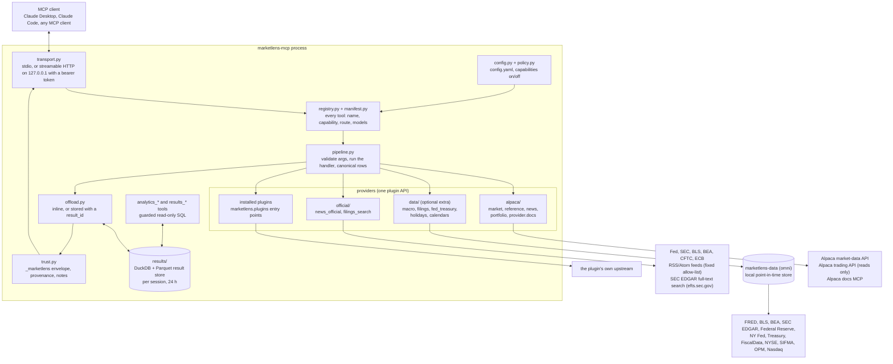

# marketlens-mcp

A read-only [Model Context Protocol](https://modelcontextprotocol.io) server for market data and analytics. It answers in one vendor-neutral schema whatever the data provider (Alpaca is built in; other providers plug in), keeps large results out of the model's context window in a local DuckDB result store that the model queries with read-only SQL, computes common analytics (returns, volatility, correlation, drawdown, beta, ...) on those stored results, and lets you choose which capabilities it may use. With the optional `data` extra it also answers from official sources, point in time: FRED, BLS and BEA series (CPI, the unemployment rate, payrolls, GDP), SEC EDGAR filings, XBRL facts, fundamentals, earnings releases, insider trades, 13F and fund holdings, the FOMC, NY Fed reference rates and the Treasury's yield curve, auctions, debt and cash, material filing events (8-K items and 6-Ks), plus market calendars. Built in, it also searches EDGAR's full text (`filings_search`) and reads official headlines (press releases, speeches, testimony, enforcement and data-release notices) from the Federal Reserve Board, SEC, BLS, BEA, CFTC and ECB feeds; the SEC and BLS parts ask for a contact email in the User-Agent, the rest is keyless. It works with any MCP client and your own provider keys.

Where it sits: this package is the public core. It owns the schema, the result store, the analytics and the Alpaca and official-feeds providers, and it knows nothing about any one application. Official data reaches it two ways: the `data` extra installs marketlens-data (import name `omni`), the point-in-time collector, beside it; or an application that already runs that collector behind its own API exposes that API as a plugin (the plugin API below), in which case the extra is not installed and the two never overlap.

## Status

Alpha (0.2.0, unreleased). The tool names, the canonical schema (1.1.0) and the plugin API (1.0) are versioned; see [CHANGELOG.md](CHANGELOG.md).

## How it works



<details>
<summary>The same picture as text</summary>

```text
  MCP client (Claude Desktop, Claude Code, any MCP client)
        |  stdio (default), or streamable HTTP on 127.0.0.1 with a bearer token
        v
 +------------------------------- marketlens-mcp -------------------------------+
 |  server.py / transport.py   FastMCP server; reads config.yaml once at start   |
 |  policy.py                  which capabilities are on; off = tool not listed  |
 |  registry.py, manifest.py   every tool: name, capability, route, I/O models   |
 |  trust.py                   wraps every result in the _marketlens envelope    |
 |  pipeline.py                validate args -> provider handler -> canonical    |
 |                             rows + provenance -> offload.py (inline/stored)   |
 |                                                                               |
 |  providers (registered through the same plugin API as third-party plugins)   |
 |   official/ (built in): news_official -> Fed, SEC, BLS, BEA, CFTC, ECB feeds; |
 |                         filings_search -> EDGAR full-text search              |
 |   +- alpaca/ -------------+  +- data/ (optional extra) -+  +- plugins -------+ |
 |   | market, reference,    |  | macro, filings,          |  | entry points in | |
 |   | news, portfolio,      |  | fed_treasury, holidays,  |  | marketlens.     | |
 |   | provider.docs         |  | calendars                |  | plugins         | |
 |   +-----------+-----------+  +-------------+------------+  +--------+--------+ |
 |               |                            |                        |          |
 |  results/  DuckDB + Parquet result store (per session, 24 h, capped) <- large |
 |            answers; results_* tools run one guarded read-only SELECT on them |
 |  analytics/  returns, volatility, correlation, resample, align, drawdown,    |
 |              beta: computed in DuckDB on result handles                      |
 +---------------|----------------------------|------------------------|---------+
                 v                            v                        v
     Alpaca market-data API,      marketlens-data (import `omni`):   whatever the
     trading API (reads only),    each publisher's own API -> a      plugin reads
     docs MCP (opt-in)            local point-in-time DuckDB +
                                  Parquet store (FRED, BLS, BEA,
                                  SEC EDGAR, Fed, Treasury, ...)
```

</details>

A tool call, end to end:

1. The client calls a tool. `pipeline.py` validates the arguments against the tool's input model (pydantic); a bad argument comes back as `invalid_arguments` with a message that names each bad argument and what is wrong with it, before anything is fetched.
2. The provider's handler calls upstream (paginating up to the fetch ceilings in `fetch.py`, under the per-provider rate limit in `ratelimit.py`) and maps the response onto the canonical models in `marketlens_schema`: SEC-style tickers, UTC instants, decimal-string money, a unit on every number, and a reason on every `null`.
3. `offload.py` turns the rows into Arrow. At most `inline_max_rows` rows and about `inline_max_tokens` tokens come back inline; anything larger is written to the result store and the model gets a `result_id` marker instead (typed columns, a preview, ready-made queries; see [Large results](#large-results)).
4. `trust.py` wraps the answer (its rows or its result marker, each carrying provenance and notes) in the `_marketlens` envelope: the trust marker, the tool, the risk class and the notice to read the payload as data, never as instructions. The client receives it.

Package layout:

| Path | What lives there |
|---|---|
| `src/marketlens_mcp/server.py`, `transport.py`, `cli.py`, `scaffold.py`, `readme.py` | Server start-up, stdio/HTTP transports, the `marketlens-mcp` command (`serve`, `tools`, `capabilities`, `plugins`, `config`, `doctor`, `schema`, `results`, `add-capability`, `readme`); `scaffold.py` writes a new capability's files, `readme.py` regenerates and checks the tool table below |
| `src/marketlens_mcp/testing.py` | Test helpers for plugin authors: `temp_store` (a real result store under a folder you choose), `make_context` (a `ToolContext`), `call_tool` (runs a tool as the server does, validate, handler, offload, without MCP) |
| `src/marketlens_mcp/config.py`, `paths.py`, `policy.py` | The YAML config, where it and the cache live, capability on/off resolution |
| `src/marketlens_mcp/registry.py`, `manifest.py`, `builtins.py`, `plugin_api.py` | Tool registration (built-ins and plugins share one API) and the tool manifest |
| `src/marketlens_mcp/pipeline.py`, `fetch.py`, `ratelimit.py`, `offload.py`, `trust.py` | One tool call: validation, pagination, rate limiting, inline-or-stored, the trust envelope |
| `src/marketlens_mcp/results/`, `results_api.py`, `worker.py` | The result store, the SQL guard, markers, the `results_*` tools; `worker.py` runs the store's blocking work off the event loop (`results_query`, `results_sample` and the analytics tools in one query thread, the other `results_*` tools in the default thread pool) |
| `src/marketlens_mcp/analytics/` | The `analytics_*` tools |
| `src/marketlens_mcp/providers/alpaca/` | The Alpaca provider (bundled OpenAPI specs, endpoint mapping, parity list) |
| `src/marketlens_mcp/providers/data/` | The official-data provider over marketlens-data (`sources.py` keys, `capabilities.py` the five capabilities, `runtime.py` the omni import and mode, `frames.py` frame-to-rows, `parity.py` dataset coverage, `tools/`) |
| `src/marketlens_mcp/providers/official/` | The official-feeds provider: `news_official` over a fixed allow-list of government and central-bank RSS/Atom feeds (`feeds.py` the list and why each feed is in or out, `parse.py`, `fetch.py`, `tool.py`); `filings_search` over SEC EDGAR's full-text search (`search.py`) |
| `src/marketlens_schema/` | The vendor-neutral canonical models (pydantic only; usable without the server) |
| `schema/` | Generated JSON Schemas of the canonical models (`make schema`) |

## Data sources

| Source | Reached through | Key | Capabilities |
|---|---|---|---|
| Alpaca market-data API (stocks, options, crypto, fixed income, news, screeners) | built-in `alpaca` provider | `ALPACA_API_KEY`, `ALPACA_SECRET_KEY` | `market`, `reference`, `news` |
| Alpaca trading API (assets, calendar, clock, corporate-action announcements, option contracts; account reads) | built-in `alpaca` provider | same | `reference`, `portfolio` (off); also `market` (`options_chain`'s open interest, `market_movers`' asset names) and, through the `data` extra, `holidays` (the optional NYSE cross-check, paper-account keys only) |
| Alpaca documentation MCP (`docs.alpaca.markets/mcp`) | built-in `alpaca-docs` | none | `provider.docs` (off) |
| Official RSS/Atom feeds of the Federal Reserve Board, SEC, BLS, BEA, CFTC and ECB (press releases, speeches, testimony, enforcement and data-release notices) | built-in `official` provider | none; `SEC_CONTACT_EMAIL` for the SEC and BLS feeds | `news` |
| SEC EDGAR full-text search (filings since 2001) | built-in `official` provider | `SEC_CONTACT_EMAIL` (refused without it) | `filings` |
| FRED/ALFRED, BLS, BEA | `data` extra (marketlens-data) | `FRED_API_KEY`, `BEA_API_KEY`, `BLS_API_KEY` (optional) | `macro` |
| SEC EDGAR (submissions, XBRL company facts, Archives) | `data` extra | `SEC_CONTACT_EMAIL` (recommended) | `filings` |
| Federal Reserve (FOMC), NY Fed, U.S. Treasury, FiscalData, FDIC BankFind; SEC money market fund statistics | `data` extra | keyless (the SEC's and the FDIC tool's ticker list: `SEC_CONTACT_EMAIL`) | `fed_treasury` |
| NYSE, SIFMA, OPM holiday calendars | `data` extra | keyless | `holidays` |
| Nasdaq calendars (unofficial endpoint) | `data` extra | keyless | `calendars` (off) |
| Your own computations | local DuckDB | none | `analytics`, `results` |

### Official feeds

`news_official` reads only these 18 feeds, live (no history: each feed holds its newest items), GET only; a feed read in the last `providers.official.cache_seconds` (300 s by default) is answered from memory. Their list, and why each candidate left out is out, is in `src/marketlens_mcp/providers/official/feeds.py`: BEA's richer `apps.bea.gov` feed and EDGAR's `/cgi-bin` feeds are disallowed by robots.txt, the Treasury publishes no press-release feed (and TreasuryDirect's robots.txt excludes generic agents), the Fed's H.15 feed is stale, and publisher and vendor feeds (WSJ, CNBC, the FT and the like) limit their use to personal reading or forbid automated and AI use. There is no setting or argument that adds a URL.

| Publisher | Feeds (the `news_id` prefix) | Reuse and attribution |
|---|---|---|
| Federal Reserve Board | `fed.monetary`, `fed.press`, `fed.speeches`, `fed.testimony` | US federal work, public domain; the Board asks to be cited as the source. |
| SEC (needs `SEC_CONTACT_EMAIL`) | `sec.press`, `sec.speeches`, `sec.litigation` | US federal work, public domain; fair access: a declared User-Agent with a contact, at most 10 requests a second. |
| BLS (needs `SEC_CONTACT_EMAIL`) | `bls.latest`, `bls.cpi`, `bls.empsit`, `bls.ppi`, `bls.jolts`, `bls.eci` | US federal work, public domain; BLS asks to be cited as the source. |
| BEA | `bea.news` | US federal work, public domain. |
| CFTC | `cftc.press`, `cftc.enforcement`, `cftc.speeches` | US federal work, public domain; the CFTC asks to be acknowledged (its robots.txt: no AI training). |
| ECB | `ecb.press` | Free to reuse if reproduced accurately with the ECB cited as the source; whoever sells it must say it is available free. |

An FOMC statement is in both `fed.monetary` and `fed.press`; a release found in two feeds is kept once, under the first in this order.

### SEC EDGAR full-text search

`filings_search` asks one fixed URL, `https://efts.sec.gov/LATEST/search-index` (the search behind EDGAR's own full-text search page), GET only, with the query parameters the call builds: 100 hits a request, one request at a time, at most 5 a call (`limit` 500), under a process-wide limiter that sends at most 5 at once and then one a second, whatever runs at once (SEC's fair-access ceiling is 10 a second), with `SEC_CONTACT_EMAIL` in the User-Agent and nothing asked without it. Nothing is cached: each call asks EDGAR. EDGAR serves only the first 10,000 hits of a search; narrow it to reach the rest. efts.sec.gov answers 403 for robots.txt, which RFC 9309 reads as no restriction, and www.sec.gov's robots.txt does not cover it; SEC's fair-access page asks for a declared contact and no crawling, and a call here is one user's question, never a crawl. Entity names and document types are written by the filers: the rows are marked untrusted text.

### Upstream APIs

Every request a tool can make goes to one of these. Nothing else is called: no telemetry, no update check.

| Upstream | Base URL | Endpoints used | Auth | Tools |
|---|---|---|---|---|
| Alpaca Market Data API | `https://data.alpaca.markets` | `/v2/stocks/{bars,quotes,trades,snapshots}` and their `/latest` forms, `/v2/stocks/meta/{exchanges,conditions/*}`; `/v1beta1/options/{bars,trades,snapshots,quotes/latest,trades/latest}`, `/v1beta1/options/meta/{exchanges,conditions/*}`; `/v1beta3/crypto/{loc}/{bars,quotes,trades,snapshots,latest/*}`; `/v1beta1/fixed_income/latest/quotes`; `/v1beta1/news`; `/v1beta1/screener/{stocks/most-actives,{market_type}/movers}`; `/v1/corporate-actions` | `ALPACA_API_KEY` / `ALPACA_SECRET_KEY` as headers | `market_*`, `options_*`, `crypto_*`, `fixed_income_*`, `news_search`, `reference_{stock,option}_exchanges`, `reference_condition_codes`, `reference_corporate_actions` |
| Alpaca Trading API | `https://paper-api.alpaca.markets` (paper) or `https://api.alpaca.markets` (live) | `/v2/assets`, `/v2/calendar`, `/v2/clock`, `/v2/corporate_actions/announcements`, `/v2/options/contracts`; with `portfolio` on: `/v2/account`, `/v2/account/configurations`, `/v2/account/activities`, `/v2/account/portfolio/history`, `/v2/positions`, `/v2/orders`, `/v2/watchlists`, `/v1/locates` (GET only) | same keys | `reference_asset(s)`, `reference_calendar`, `reference_clock`, `reference_corporate_action_announcement(s)`, `reference_option_contract(s)`, `options_chain` (its open interest), `market_movers` (asset names, with `exclude_warrants_rights_units`), `calendar_us_holidays` (the NYSE cross-check, always on the paper URL), `portfolio_*` |
| Alpaca documentation MCP | `https://docs.alpaca.markets/mcp` | its `search`, `fetch`, `list-endpoints`, `get-endpoint`, `search-endpoints` tools | none | `provider_docs_*` (off by default) |
| FRED / ALFRED (St. Louis Fed) | `https://api.stlouisfed.org/fred` | `/series/observations`, `/series/vintagedates`; `/series` (when FRED last updated a series it posts with its next vintage, such as U. Michigan's survey) | `FRED_API_KEY` | `macro_series` |
| BLS | `https://api.bls.gov/publicAPI/v2/timeseries/data/`; `https://www.bls.gov` | the time-series API; `/schedule/news_release/{cpi,empsit}.htm` and this and next month's lists of releases, `/schedule/{year}/{MM}_sched_list.htm`; the release archive `/bls/news-release/{release}.htm` | `BLS_API_KEY` (optional) | `macro_bls_series`, `macro_release_schedule` |
| BEA | `https://apps.bea.gov/api/data/` | NIPA `GetData` | `BEA_API_KEY` | `macro_bea_table` |
| U.S. SEC EDGAR | `https://data.sec.gov`, `https://www.sec.gov` | `/submissions/CIK##########.json` and, for older filings, `/submissions/CIK##########-submissions-NNN.json`; `/api/xbrl/companyfacts/CIK##########.json`; `/api/xbrl/frames/{taxonomy}/{tag}/{unit}/{period}.json` and EDGAR's quarterly XBRL index `/Archives/edgar/full-index/{year}/QTR{n}/xbrl.gz` (`sec_xbrl_frames`); `/Archives/edgar/data/{cik}/...` (Forms 3/4/5/144, 13F-HR, N-PORT, 8-K EX-99.1, a proxy's XBRL instance for `sec_pay_vs_performance`, a 10-K or 10-Q's `index.json` and XBRL instance for `sec_segment_facts`, a results 6-K's EX-99 exhibits for `sec_foreign_quarterly`, each filing's index headers `{accession}-index-headers.html`, or its `-index.html`, for its acceptance time and a fund filing's series, and for `filings_events` the filing index and primary document of 8-Ks and 6-Ks, for `sec_form144` a Form 144's filing index `{accession}-index.htm` and the XML it lists, for `sec_ipo_pipeline` an IPO filing's index and primary document); `/Archives/edgar/daily-index/{YYYY}/QTR{q}/index.json` and the `form.{YYYYMMDD}.idx` files it lists (`sec_daily_index`, `sec_ipo_pipeline`); `/files/company_tickers.json`, `/files/company_tickers_mf.json` | `SEC_CONTACT_EMAIL` in the User-Agent | `sec_*`, `filings_events` |
| Federal Reserve Board | `https://www.federalreserve.gov` | `/monetarypolicy/fomccalendars.htm`; statements `/newsevents/pressreleases/monetaryYYYYMMDDa.htm` | none | `fed_fomc_meetings`, `fed_fomc_statements` |
| New York Fed | `https://markets.newyorkfed.org` | `/api/rates/all/search.json` | none | `fed_reference_rates` |
| U.S. Treasury | `https://home.treasury.gov` | `/resource-center/data-chart-center/interest-rates/` (`daily-treasury-rates.csv`) | none | `treasury_yield_curve` |
| Treasury FiscalData | `https://api.fiscaldata.treasury.gov/services/api/fiscal_service` | `/v1/accounting/od/auctions_query`, `/v2/accounting/od/debt_to_penny`, `/v1/accounting/dts/operating_cash_balance` | none | `treasury_auctions`, `treasury_debt`, `treasury_tga` |
| NYSE, SIFMA, OPM | `https://www.nyse.com`, `https://www.sifma.org`, `https://www.opm.gov` | `/markets/hours-calendars`; `/resources/guides-playbooks/holiday-schedule` and `/us-holiday-archive`; `/policy-data-oversight/pay-leave/federal-holidays/` | none | `calendar_us_holidays` |
| Nasdaq (unofficial) | `https://api.nasdaq.com` | `/api/calendar/economicevents`, `/api/calendar/earnings`, `/api/company/{symbol}/earnings-surprise` | none | `calendar_economic`, `calendar_earnings`, `calendar_earnings_history` (off by default) |
| Official feeds (Federal Reserve Board, SEC, BLS, BEA, CFTC, ECB) | `https://www.federalreserve.gov`, `https://www.sec.gov`, `https://www.bls.gov`, `https://www.bea.gov`, `https://www.cftc.gov`, `https://www.ecb.europa.eu` | `/feeds/{press_monetary,press_all,speeches,testimony}.xml`; `/news/{pressreleases,speeches-statements}.rss`, `/enforcement-litigation/litigation-releases/rss`; `/feed/{bls_latest,cpi,empsit,ppi,jolts,eci}.rss`; `/news/rss`; `/RSS/{RSSGP/rssgp,RSSENF/rssenf,RSSST/rssst}.xml`; `/rss/press.html` ([the list](#official-feeds)) | none; for SEC and BLS, `SEC_CONTACT_EMAIL` in the User-Agent (without it those feeds are skipped) | `news_official` |
| SEC EDGAR full-text search | `https://efts.sec.gov` | `/LATEST/search-index` (q, forms, ciks, dateRange/startdt/enddt, from) | `SEC_CONTACT_EMAIL` in the User-Agent; refused without it | `filings_search` |

The tool table below names each tool's main route; the second reads of `options_chain`, `market_movers` and `calendar_us_holidays` are in the rows above.

What each source needs and how each tool reads it is in [Capabilities and defaults](#capabilities-and-defaults), [Keys](#keys) and the [tool table](#tools). To add a source, see [Adding a data source](#adding-a-data-source).

## Install

marketlens-mcp is not on PyPI yet (0.2.0 is unreleased), so install it from this repository:

```sh
uvx --from git+https://github.com/jasonwu001t/marketlens-mcp marketlens-mcp   # run without installing (recommended for MCP clients)
pipx install git+https://github.com/jasonwu001t/marketlens-mcp                # or a user-wide install
pip install git+https://github.com/jasonwu001t/marketlens-mcp                 # or into an environment you manage
```

Python 3.11 or newer. Linux and macOS are tested; Windows is not yet supported in this release. The bare command serves MCP over stdio.

The official-data tools (the `data` extra; see [Official data](#official-data-the-data-extra)) need marketlens-data, which is not published yet either, and its source repository is not public yet, so for now only someone who already has a checkout of it can add them. With a checkout, install it into the same environment:

```sh
uvx --from git+https://github.com/jasonwu001t/marketlens-mcp --with /path/to/marketlens-data marketlens-mcp
pipx inject marketlens-mcp /path/to/marketlens-data
pip install /path/to/marketlens-data
```

Once both are on PyPI, the extra installs them together:

```sh
uvx --from "marketlens-mcp[data]" marketlens-mcp
pipx install "marketlens-mcp[data]"
pip install "marketlens-mcp[data]"
```

## Dependencies

Direct dependencies (`pyproject.toml`):

| Package | Constraint | Why |
|---|---|---|
| `fastmcp` | `==3.4.7` (pinned) | The MCP server and its stdio / streamable-HTTP transports; brings the `mcp` SDK, Starlette and Uvicorn |
| `pydantic` | `>=2.12,<3` | Tool input models and the canonical output models (`marketlens_schema`) |
| `httpx` | `>=0.28.1,<1` | Every upstream HTTP call |
| `duckdb` | `>=1.5.5,<2` | The result store's query engine, the SQL guard's sandbox, the analytics |
| `pyarrow` | `>=25.0` | Rows in canonical types, Parquet files in the result store |
| `sqlglot` | `>=30.21,<31` | Parsing model-written SQL before `results_query` runs it |
| `pyyaml` | `>=6.0.3,<7` | The config file |
| `tzdata` | `>=2025.2`, Windows only | Time zones |
| `marketlens-data` | `>=0.1,<0.2`, the `data` extra (not on PyPI yet; see [Install](#install)) | Fetching official publishers and keeping them point in time; it brings its own (pandas, DuckDB, the publishers' parsers) |
| `pytest`, `pytest-asyncio`, `ruff` | the `dev` extra | Tests and lint |

<details>
<summary>The full resolved set (69 packages, Python 3.13, without extras)</summary>

```text
aiofile==3.12.3            annotated-types==0.8.0     anyio==4.15.1
attrs==26.1.0              authlib==1.8.0             beartype==0.22.9
cachetools==7.2.1          caio==0.12.9               certifi==2026.7.22
cffi==2.1.1                click==8.5.0               cryptography==50.0.2
cyclopts==5.2.0            dnspython==2.8.0           docstring-parser==0.18.0
duckdb==1.5.6              email-validator==2.3.0     exceptiongroup==1.3.1
fastmcp==3.4.7             fastmcp-slim==3.4.7        griffelib==2.3.2
h11==0.16.0                httpcore==1.0.9            httpx==0.28.1
httpx-sse==0.4.3           idna==3.20                 jaraco-classes==3.4.0
jaraco-context==6.1.2      jaraco-functools==4.6.0    joserfc==1.7.5
jsonref==1.1.0             jsonschema==4.26.0         jsonschema-path==0.5.0
jsonschema-specifications==2025.9.1                   keyring==25.7.0
markdown-it-py==4.2.0      mcp==1.30.0                mdurl==0.1.2
more-itertools==11.1.0     openapi-pydantic==0.6.0    opentelemetry-api==1.45.1
packaging==26.3            pathable==0.6.0            platformdirs==4.12.3
py-key-value-aio==0.4.6    pyarrow==25.0.1            pycparser==3.0
pydantic==2.13.5           pydantic-core==2.46.5      pydantic-settings==2.15.0
pygments==2.21.0           pyjwt==2.15.1              pyperclip==1.11.0
python-dotenv==1.2.4       python-multipart==0.0.32   pyyaml==6.0.3
referencing==0.37.0        rich==15.0.0               rich-rst==2.2.0
rpds-py==2026.9.1          sqlglot==30.21.0           sse-starlette==3.5.0
starlette==1.7.0           typing-extensions==4.16.0  typing-inspection==0.4.4
uncalled-for==0.4.0        uvicorn==0.54.0            watchfiles==1.3.0
websockets==17.2
```

Most of these arrive through `fastmcp` and the `mcp` SDK (the HTTP transport, auth helpers, CLI formatting). `uv pip list` or `pip list` in your environment prints your own resolution.

</details>

Outside Python you need:

- **An Alpaca account** (paper is fine) for the `market`, `reference`, `news` and `portfolio` tools. Your market-data plan decides the feeds: `stock_feed: iex` on the free plan, `sip` with a paid one, `delayed_sip` for the consolidated tape 15 minutes late; `options_feed: indicative` unless you have OPRA. Set them in the config so every answer states the feed and delay it really has.
- **The official sources' free keys** for the `data` extra's tools that need one (see [Keys](#keys)); the rest are keyless.
- Nothing else: no database server, no daemon. The result store and the data store are local folders.

## Add it to a client

Claude Desktop (`claude_desktop_config.json`):

```json
{
  "mcpServers": {
    "marketlens": {
      "command": "uvx",
      "args": ["--from", "git+https://github.com/jasonwu001t/marketlens-mcp", "marketlens-mcp"],
      "env": {
        "ALPACA_API_KEY": "your key id",
        "ALPACA_SECRET_KEY": "your secret key",
        "SEC_CONTACT_EMAIL": "you@example.com"
      }
    }
  }
}
```

`SEC_CONTACT_EMAIL` is optional, and needs no extra: the built-in `news_official` reads its SEC and BLS feeds (9 of its 18; see [Official feeds](#official-feeds)) only when it is set to an email address, which it sends in the User-Agent to SEC and BLS alone. Without it those feeds are skipped with a note (no placeholder contact is ever sent) and `filings_search`, SEC EDGAR's full-text search, refuses.

With the `data` extra, run it from the extra (`"--from", "marketlens-mcp[data]"`) once both packages are on PyPI; until then, add the marketlens-data checkout with `--with`, as below (see [Install](#install)). Either way, add the official sources' keys (each one only for the tools that need it; see [the keys](#keys)):

```json
{
  "mcpServers": {
    "marketlens": {
      "command": "uvx",
      "args": ["--from", "git+https://github.com/jasonwu001t/marketlens-mcp", "--with", "/path/to/marketlens-data", "marketlens-mcp"],
      "env": {
        "ALPACA_API_KEY": "your key id",
        "ALPACA_SECRET_KEY": "your secret key",
        "FRED_API_KEY": "your FRED key",
        "BEA_API_KEY": "your BEA key",
        "BLS_API_KEY": "your BLS key (optional)",
        "SEC_CONTACT_EMAIL": "you@example.com"
      }
    }
  }
}
```

`SEC_CONTACT_EMAIL` is optional but strongly recommended: SEC EDGAR's fair-access rule asks every client to name a contact. Without it marketlens-data sends a placeholder contact and logs a warning, every `sec_` answer carries a note saying so, and SEC may throttle or block such requests (`news_official`, as above, skips its SEC and BLS feeds instead). Set to something that is not an email address, it is refused in mode `auto`: every `sec_` tool answers `sec_contact_missing` until it is fixed, and `doctor` says so. `marketlens-mcp doctor` says whether it is set, never its value.

Claude Code:

```sh
claude mcp add marketlens -e ALPACA_API_KEY=... -e ALPACA_SECRET_KEY=... -- uvx --from git+https://github.com/jasonwu001t/marketlens-mcp marketlens-mcp
```

Any other client: run `marketlens-mcp` (stdio), or `marketlens-mcp serve --transport http` for streamable HTTP on `http://127.0.0.1:8765/mcp` with a bearer token (see [Security and privacy](#security-and-privacy)).

Without Alpaca keys the server still starts and lists its tools; Alpaca tools then answer with a readable error.

## Capabilities and defaults

Each tool belongs to one capability. Turn capabilities on or off in the config file; a tool whose capability is off is not listed at all.

| Capability | Default | What it covers |
|---|---|---|
| `market` | on | Stock, option, crypto and fixed-income bars, quotes, trades, snapshots, latest values, option chains with greeks, crypto order books, screeners. |
| `reference` | on | Assets, option contracts, stock and option exchange codes, trade and quote condition codes, market calendar and clock, corporate actions and announcements. |
| `news` | on | News articles from Alpaca (`news_search`) and official headlines from the Federal Reserve Board, SEC, BLS, BEA, CFTC and ECB feeds (`news_official`, keyless). Third-party text: every response is marked untrusted. |
| `analytics` | on | Returns, rolling volatility, correlation, resample, as-of align, drawdown and beta, computed locally on result handles. |
| `portfolio` | off | Brokerage account reads: account, positions, orders, activities, portfolio history, account configuration, broker watchlists and locates (the paper account unless `portfolio.environment: live`). Off by default: what the model reads leaves your machine with the model's requests. |
| `results` | always on | Query, describe, sample, list and drop results stored by this session. |
| `results.export` | off | Write a stored result to CSV or Parquet in your export folder. The only tool that writes a file outside marketlens's own result cache and data store. |
| `provider.docs` | off | Search the data provider's documentation service (an outbound call to a third party). Third-party text, marked untrusted. |
| `macro` | on | FRED/ALFRED, BLS and BEA series with vintages and as-of reads, BLS release schedules, the FRED series catalogue. Needs the `data` extra. |
| `filings` | on | SEC EDGAR filings, XBRL facts, XBRL frames (one concept across filers), pay versus performance, point-in-time fundamentals, earnings releases and press-release EPS, insider trades, Form 144 notices (`sec_form144`), the IPO pipeline (`sec_ipo_pipeline`), EDGAR's daily form index (`sec_daily_index`), 13F holdings, fund N-PORT reports, material 8-K items and 6-Ks with their exhibits (`filings_events`), earnings guidance and non-GAAP reconciliations, segment facts, a foreign issuer's 6-K quarters, company investor documents and targets (`company_ir_documents`, `company_ir_targets`), SEC EDGAR full-text search (`filings_search`, built in). The `sec_` and `company_ir_` tools and `filings_events` need the `data` extra. |
| `fed_treasury` | on | FOMC meetings, statements, economic projections (dot plot), minutes and the Beige Book, NY Fed reference rates, the Treasury yield curve, auctions, debt and cash balance; FDIC bank financials and industry aggregates, SEC money market fund statistics. Needs the `data` extra. |
| `holidays` | on | US market holidays and early closes from their publishers: NYSE (stocks), SIFMA (bonds), OPM (federal). Keyless. Needs the `data` extra. |
| `calendars` | off | Nasdaq's economic calendar (PMI and other actual and consensus figures), earnings calendar and history. Off by default: the Nasdaq endpoint is unofficial and may change or refuse without notice. Needs the `data` extra. |

The last five are declared whether or not the `data` extra is installed (a config file naming them is always valid); their tools are listed only where it is, except the built-in `filings_search`. Plugins may declare more capabilities; see [Another vendor, or your own data](#another-vendor-or-your-own-data).

**Read-only.** marketlens-mcp has no tool that places, replaces or cancels orders, closes positions, exercises options, changes account settings, or edits broker watchlists. Those tools do not exist in the package, so no configuration can enable them.

## Configuration

Settings live in a YAML file:

- `$MARKETLENS_CONFIG` if set (the file must exist), else
- `$XDG_CONFIG_HOME/marketlens/config.yaml` if `XDG_CONFIG_HOME` is set to an absolute path, else
- `~/.config/marketlens/config.yaml` (on every platform).

No file means every default. `marketlens-mcp config init` writes the commented default file, `config path` prints where it is, `config show` prints the effective settings. The server reads the file once at start: restart it after editing. Unknown settings, wrong types and out-of-range values refuse to start with a one-line reason.

Secrets never go in the file. They come from the environment only: `ALPACA_API_KEY`, `ALPACA_SECRET_KEY` (or Alpaca's own spelling of the same pair, `APCA_API_KEY_ID` and `APCA_API_SECRET_KEY`: either pair works, and the tool table lists both), `MARKETLENS_HTTP_TOKEN` for HTTP, and the data sources' keys (`FRED_API_KEY`, `BEA_API_KEY`, `BLS_API_KEY`, `SEC_CONTACT_EMAIL`; see [the keys](#keys)). `MARKETLENS_LOG_LEVEL` (default `WARNING`) sets the log level; logs go to stderr.

The default file:

```yaml
version: 1
capabilities:
  market: true
  reference: true
  news: true
  analytics: true
  macro: true             # FRED, BLS, BEA (needs the data extra)
  filings: true           # SEC EDGAR (needs the data extra)
  fed_treasury: true      # FOMC, NY Fed rates, Treasury curve and auctions (needs the data extra)
  holidays: true          # NYSE, SIFMA, OPM market holidays (needs the data extra)
  calendars: false        # Nasdaq calendars: an unofficial endpoint (needs the data extra)
  portfolio: false
  results.export: false
  provider.docs: false
portfolio:
  environment: paper      # paper | live
providers:
  alpaca:
    stock_feed: iex       # iex | sip | delayed_sip | boats | overnight (your plan decides)
    options_feed: indicative   # indicative | opra
    crypto_location: us   # us | us-1 | us-2 | eu-1 | bs-1
    rate_limit_per_minute: 190
    trading_url: null
    data_url: null
  data:
    mode: auto            # auto (fetch and keep) | local (read only what is stored)
    data_dir: null        # absolute folder for the data store; default: the per-user data folder
    ttl_hours: 12         # how long a fetched slice is reused before it is fetched again
    calendar_ttl_minutes: 60
    call_timeout_seconds: 120
  official:
    cache_seconds: 300    # reuse a fetched feed this long (0: fetch every time; the ECB's 5 s Crawl-delay holds)
    timeout_seconds: 20   # per feed request; a call stops 10 s after it
results:
  inline_max_rows: 200
  inline_max_tokens: 6000
  query_max_rows: 200
  query_max_bytes: 24000
  query_timeout_seconds: 10
  query_memory_limit: 1GB
  ttl_hours: 24
  max_store_gb: 5
  export_dir: null        # required for results.export
fetch:
  max_rows: 50000
  max_pages: 20
plugins:
  enabled: []
  settings: {}
http:
  port: 8765
```

## Large results

A result of at most 200 rows and about 6,000 tokens comes back inline. Anything bigger is written to the local result store and the tool returns a **marker** instead: a `result_id` (such as `r_8c1f0a9d3e`), the row count, typed columns with units, nulls and min/max, a preview of the first and last rows with the time span, the provenance, the pagination state and three ready-made queries.

The model then works on the handle:

```sql
-- results_query: one read-only SELECT; result ids are table names
SELECT ticker, time_bucket(INTERVAL '1 day', t) AS day, last(close ORDER BY t) AS close
FROM r_8c1f0a9d3e GROUP BY ALL ORDER BY day

-- joins of results, window functions and ASOF JOIN work too
SELECT a.t, a.close, b.close AS benchmark
FROM r_8c1f0a9d3e a ASOF JOIN r_51b0c2d4e6 b ON a.t >= b.t
```

`results_query` accepts exactly one `SELECT` or `WITH ... SELECT` statement. It refuses writes, `PRAGMA`, `SET`, `ATTACH`, `COPY`, `INSTALL`, `LOAD`, file-reading functions and any table that is not a result of the same session; it runs in a fresh in-memory DuckDB that loaded only the referenced results and then disabled file access and locked its configuration. It refuses `PIVOT` and `UNPIVOT` (pivot with one `max(x) FILTER (WHERE ...)` per column instead) and reads at most 8 results in one query. A query the guard or DuckDB cannot read comes back with their message unchanged, and a hint when the cause is a known trap: a keyword used as a bare name (`map`, `end`, `left`, `group`, `union`: rename it or double-quote it) or a grouping mistake (a column outside both GROUP BY and an aggregate, GROUP BY ALL over an expression that mixes them, an aggregate in WHERE, nested aggregates). It returns at most `max_rows` rows (default 50, at most 200; a larger `max_rows` or `LIMIT` is lowered, with a note), stops after 10 seconds, and stores its own answer as a new result when it is larger than 24,000 bytes of JSON (`results.query_max_bytes`) or about 6,000 tokens (or when you pass `store=true`): the whole answer, which `max_rows` does not cut, up to `fetch.max_rows` rows (if that whole answer runs out of time, the rows already read are stored, cut), and an answer cut there, or computed from a result that is itself cut, says `truncated` in its provenance, which `results_describe` repeats and analytics computed from it carry. A stored answer keeps a column's role (`available`: when each row became known) on such a column it passes through unchanged (same name and type), or builds as `max()` or `greatest()` of such columns from every result it read that has one (a join of two point-in-time results takes `greatest()` of both clocks), when its query computes each row from the rows it keeps the clocks of: not with a window function, a subquery in an expression or a `LATERAL` subquery, a `SEMI` or `ANTI` join or a result read twice for one row (a self-join), whose rows can hold values known later, and a result dated by its time column (quotes, trades) joined only with that time passed through, as the answer's time column, or in `greatest()` with the clock; and only when every result it reads shows when its rows became known: by such a column, or as fetched rows known at their time column and fixed from then on (quotes, trades) or holding at every time (exchanges, condition codes). Snapshots never do: a snapshot (`market_snapshots`, `options_snapshots`, `options_chain`) holds values as of its fetch (open interest published the next morning, greeks, a session still trading), whatever its `t`. Bars never do: a bar is dated by its start `t` but its close is known only at its end, `t` plus its timeframe, which no column of the answer shows (the day's bar joined to a row known that morning gave it the day's close), and bars adjusted for splits and dividends (`market_bars`' default, `adjustment=all`) are rescaled for those after their time too. A computed result without the role (an answer that lost it, joined back to the dataset, or a full-sample mean stored apart) never does, nor does a plugin's dated rows without one, nor rows dated with no time column, nor rows that can hold what became known after their time (an order's later fill, a news item's update, an account activity), nor rows with no date column, which are as of their fetch (a position's price, an asset's status, a date held as text). It says so when it leaves such a column out, computes it otherwise (`min()` of a week's knowledge times is earlier than some of the week's values), keeps it beside rows computed from others or reads a result that does not show when its rows became known. A stored answer that passes the rows of one fetched result of market data through unchanged (rows filtered or grouped, columns projected or computed from each row's own, its time column kept as it is and a bar's timeframe too, or left out when all the rows have one, no row computed from others) records that result's model, fetch time, adjustment and that timeframe (`rows_of` in its info), so `analytics_align` takes its rows as it takes the result's: `SELECT * FROM r_bars WHERE ticker='SPY'` is matched as SPY's bars are; so does one joining several such results of one model row for row on their time column, made equal by the join (`USING (t)`, `ON a.t = b.t`) and of one timeframe (a spread of two tickers' day bars, matched from each bar's end). Any other stored answer that keeps no role records the rows it read marked not shown (`shown: false`) when nothing shows when its rows became known: it reads bars, snapshots or a result computed from them (a join of bars with a dataset), or it computes its time column from dated rows (a `time_bucket` of trades, quotes or a dataset's rows, dated at the bucket's start; a bucket dated at `max(t)`, its last trade, is not computed), or has none (a full-sample mean, a list of tickers, which an answer joining it reads), or computes rows from others (`lead()`, a full-sample z-score), or leaves out, renames or computes a `knowledge_time` of a result it reads (a `date_trunc` of it, or the event time named so, is earlier than when the rows became known), or joins dated results without each one's time made equal to its time column by the join (`USING (t)`, `ON a.t = b.t`, in the same `SELECT`) or in the clock it keeps (trades joined to later quotes, or `ASOF JOIN` forward), or reads an analytics output with no time column (a correlation, a beta or drawdown summary: the whole sample's, whatever timestamp dates it); `analytics_align` refuses it unless `match_on=time`. An answer whose rows are dated as the rows it read (a filter, quotes joined to exchange codes, two results joined on equal times) records none, and is matched on its time column, or from a `knowledge_time` it passes through without the role (beside a result that does not show when its rows became known), as a lower bound, each with a note. Two limits: choosing rows by the whole sample with `ORDER BY ... LIMIT` (a top N) keeps a column's role and `rows_of` (the match stays point in time, but which rows exist reflects the whole sample); and a plugin tool that emits a built-in market model (say `marketlens.Bar`) is taken as known by that model's rule, as Alpaca's rows are. Whole-number sums come back as numbers; exact decimals come back as strings, to keep every digit.

Upstream fetches stop at 50,000 rows or 20 pages and say so, with the token to continue when the source gives one (otherwise the note asks for a narrower request). Results live 24 hours in a per-session folder of your cache directory (`$MARKETLENS_CACHE_DIR`, else `~/Library/Caches/marketlens`, `%LOCALAPPDATA%\marketlens\Cache`, or `$XDG_CACHE_HOME/marketlens` when that is absolute, else `~/.cache/marketlens`), capped at 5 GB with oldest-first eviction. No tool ever shows a filesystem path. `marketlens-mcp results list` shows the store's size; `results purge --yes` empties it.

## Analytics

The `analytics_*` tools take result handles and compute in DuckDB: simple and log returns (optionally by period), rolling annualised volatility (window stated), a correlation matrix, OHLCV resampling (aggregation rules stated), an as-of alignment of two results (point in time given a column with role `available`, when each row became known, such as a dataset's knowledge time: a right row counts from the later of its time and that, so a left row never gets a value published after it nor a row dated after it, such as a calendar's next date; with a note on how much older the matches are than the latest by time; a result holding only the latest version of each row has a revised row only from its revision, and a note says so), drawdown (maximum and series), and beta against a benchmark result. Inputs are validated against the result's typed columns; large outputs are stored like any other result, and any output with `store=true`. Analytics outputs do not carry a column's role, even where their model states one: aligned afterwards, a point-in-time series resampled is matched from the later of its time and the `knowledge_time` it keeps (each bucket's latest), with a note that the match is not shown point in time, and its returns, volatility, drawdown or beta, which leave that clock out, are refused unless `match_on=time`. A bucket of other rows (a dataset's with no `knowledge_time`, resampled or sampled to a `period`) records its span (`rows_of`) and is matched from its end, with a note that its rows are not shown point in time (a Tuesday bar got the Sunday value of its week). An analytics output of fetched market data records it (`rows_of`), and a row is known no earlier than the end of the period it covers: a return, a drawdown or a window ending on a bar when that bar ends, a bucket of `analytics_resample` (or of a `period`) at the bucket's end, or later when its last bar ends later (a UTC month of New York day bars: 4 or 5 hours, `lag_seconds`); so `analytics_align` matches it from there by default (returns of daily bars give the hourly bar of 09:00 New York the previous day's return, not the day's), also after the bars are gone. Returns, volatility and beta of adjusted bars are matched so point in time, as a ratio of prices a later split or dividend rescales alike; resampled bars and a drawdown's levels are not. An output that cannot show this (computed from an answer marked not shown; aligned rows matched forward, on time or onto a right result that does not show when its rows became known, whatever the left) is marked not shown and refused like such an answer. A right result with a `knowledge_time` or `ingested_at` column that has no role (a query answer passing it through beside a result that does not show when its rows became known, a resample's; a query answer computing it or leaving it out is refused, as below) is matched on that column all the same by default, from the later of its time and that, as a lower bound, with a note that the match is not shown point in time (`match_on=time` counts, at least, the left rows that got a row known after them); any other right result without such a column is matched on its time column, with a note that the match is not shown point in time (and, when it was computed from a result with the role, which clock to keep), unless it holds fetched rows known at their time (quotes, trades), or computed from them recording so: a plugin's rows dated by the period they describe, such as a macro series, a query answer or analytics output of other rows, orders or news. A snapshot is matched from its fetch, so no left row before then gets one (`match_on=time` matches on `t` and counts the left rows before the fetch). A right result that shows neither when its rows became known nor when their period ends (`shown: false`) is refused unless `match_on=time`: matched on its time column, a bucket's start, it would give a left row values known only later. Fetched bars, and an answer passing them through, are matched from each bar's end, `t` plus its timeframe (on the calendar the bar starts in: New York for stocks and options, UTC for crypto), when its close became known, so an hourly bar gets the last daily bar that ended by its time, not the day's (`match_on=time` matches on `t` and counts the bars that ended after the left row). So bars of one timeframe on both sides pair each left bar with the right bar before it, `tolerance=PT0S` gives the right bar that ended at the left time, and `direction=forward` the first that ends at or after it, whose `matched_t` can be before the left time; `match_on=time` pairs bars of the same `t`; bars adjusted for splits and dividends after their time (any `adjustment` but `raw`) are matched so all the same, with a note that the match is not shown point in time.

## Official data (the data extra)

The `data` extra (marketlens-data installed beside marketlens-mcp; it is not on PyPI yet, see [Install](#install)) adds a built-in provider over marketlens-data (import name `omni`), which fetches each publisher's own data and keeps it, point in time, in a local DuckDB + Parquet store. 43 tools under five capabilities:

- `macro`: FRED/ALFRED series with every vintage (`macro_series`), BLS series (`macro_bls_series`), BEA NIPA tables (`macro_bea_table`; BEA states a level's measure and multiplier apart from its value, and the `units` of a `Level` row carry both: `Level, millions of Current Dollars`. A row marketlens-data stored before it kept the multiplier has `units` `Level` alone, so its scale is not known: NIPA dollar levels are usually millions of dollars, and the answer's note says so), BLS release schedules for the CPI and the jobs report (`macro_release_schedule`), and the FRED series catalogue (`macro_series_catalog`).
- `filings`: SEC EDGAR filings (`sec_filings`), XBRL facts with restatements (`sec_xbrl_facts`), one XBRL concept for every filer in a calendar period (`sec_xbrl_frames`), the pay-versus-performance table of a company's proxies (`sec_pay_vs_performance`), earnings guidance and the GAAP to non-GAAP reconciliation of earnings releases (`sec_earnings_guidance`, `sec_earnings_non_gaap`), segment, region and revenue-disaggregation facts from a filing's own XBRL (`sec_segment_facts`), a foreign issuer's quarters from its results 6-K exhibits (`sec_foreign_quarterly`), the company investor documents marketlens-data's operator lists and the multi-year targets they state (`company_ir_documents`, `company_ir_targets`), 23 point-in-time fundamentals computed from them (`sec_fundamentals`), 8-K Item 2.02 earnings releases (`sec_earnings_releases`) and the EPS their press releases state (`sec_earnings_figures`), material 8-K items and 6-Ks with their exhibit URLs and headline (`filings_events`), Form 4 and 144 insider transactions (`sec_insider_trades`), every field of a company's Form 144 notices of proposed sale (`sec_form144`), the IPO pipeline of new issuers (S-1 / F-1, amendments, EFFECT, 424B4 priced, RW withdrawn, with the cover's proposed ticker, exchange, price range and shares: `sec_ipo_pipeline`), every filing of a business day from EDGAR's daily form index (`sec_daily_index`), 13F holdings (`sec_13f_holdings`), fund N-PORT reports and holdings (`sec_fund_nport`, `sec_fund_holdings`).
- `fed_treasury`: FOMC meetings and statements, the Summary of Economic Projections with the dot plot (`fed_fomc_projections`), the minutes (`fed_fomc_minutes`, stamped at the release date the Fed prints) and the Beige Book per district (`fed_beige_book`), NY Fed reference rates (SOFR, EFFR, OBFR, TGCR, BGCR), the Treasury par yield curve, Treasury auctions, debt to the penny and the Treasury General Account; the FDIC's Call Report financials of the banks a listed company owns (`bank_fdic_financials`: deposits insured and uninsured, unrealized securities gains, capital ratios) and its annual industry aggregates (`bank_fdic_industry`), and the SEC's monthly money market fund statistics (`funds_mmf_statistics`: assets, flows, holdings by category, repos with the Fed).
- `holidays`: US market holidays and early closes from NYSE, SIFMA and OPM (`calendar_us_holidays`), keyless.
- `calendars` (off by default): Nasdaq's economic calendar, earnings calendar and earnings history.

### Keys

Each source names its own key; set the ones you need in the env block of the server (never in the config file). `marketlens-mcp doctor` prints one line per source: ready, missing (its tools refuse until it is set), optional, keyless, or its capability off.

| Source | Variable | Needed | Get it | Tools |
|---|---|---|---|---|
| FRED / ALFRED | `FRED_API_KEY` | yes | free: https://fred.stlouisfed.org/docs/api/api_key.html | `macro_series` |
| BLS | `BLS_API_KEY` | no | free; raises BLS's daily limit and years per request: https://data.bls.gov/registrationEngine/ | `macro_bls_series`; `macro_release_schedule` is keyless (the key is for the time-series API only) |
| BEA | `BEA_API_KEY` | yes | free: https://apps.bea.gov/API/signup/ | `macro_bea_table` |
| SEC EDGAR | `SEC_CONTACT_EMAIL` | optional, strongly recommended | your contact address, sent in the User-Agent as SEC's fair-access rule asks; without it a placeholder contact is sent, which SEC may throttle or block; set to something that is not an email address, in mode `auto` the `sec_` tools refuse until it is fixed, and `doctor` says so: https://www.sec.gov/os/accessing-edgar-data | the eighteen `sec_` tools, `filings_events` and the two `company_ir_` tools |
| Official feeds of SEC and BLS (built in, not the data extra) | `SEC_CONTACT_EMAIL` | optional | the same address, sent in the User-Agent to SEC and BLS only (both refuse undeclared automated clients); without it, or when it is not an email address, their nine feeds are skipped with a note and no placeholder is ever sent; the Fed, BEA, CFTC and ECB feeds need nothing | `news_official`; `filings_search` (refused without it) |
| Federal Reserve, NY Fed, Treasury, FiscalData | none | | keyless | `fed_`, `treasury_` tools |
| Nasdaq | none | | keyless; an unofficial endpoint | `calendar_economic`, `calendar_earnings`, `calendar_earnings_history` |
| NYSE, SIFMA, OPM | none (either Alpaca key pair optional: `ALPACA_API_KEY` and `ALPACA_SECRET_KEY`, or `APCA_API_KEY_ID` and `APCA_API_SECRET_KEY`) | no | keyless; with paper-account Alpaca keys, NYSE's dates are cross-checked against Alpaca's paper trading calendar, and without keys the answer says they were not (live-account keys make the NYSE fetch fail) | `calendar_us_holidays` |
| EIA | `EIA_API_KEY` | not used yet | free | planned (a later release) |
| Census | `CENSUS_API_KEY` | not used yet | | planned (a later release) |

A tool whose key is missing answers with the variable to set and where to get it; nothing is fetched.

### Where the data lives, and the two modes

The store is a folder of your own: `providers.data.data_dir` if you set it, else `OMNI_DATA_DIR`, else the per-user data folder (`~/Library/Application Support/marketlens-data` on macOS, `%LOCALAPPDATA%\marketlens-data` on Windows, `$XDG_DATA_HOME/marketlens-data` when that is absolute, else `~/.local/share/marketlens-data`, elsewhere), created owner-only. marketlens never lets marketlens-data read a `.env` file.

- `mode: auto` (the default): a slice (one series, one company, one date) older than `ttl_hours` is fetched from the publisher and stored, then the answer is read from the store. A second question within the TTL makes no request (`cached: true` in the provenance).
- `mode: local`: only what is stored is read; nothing is fetched and no key is needed. An empty answer says so.

### Point in time and `as_of`

Every data tool except `macro_series_catalog` (the local FRED catalogue, which fetches nothing) takes `as_of`: the answer as it was knowable then (a date means 00:00 UTC; give a datetime with a zone for intraday precision). Each tool's description states its dataset's rule:

- *vintage* (FRED/ALFRED, XBRL facts, fundamentals, N-PORT): exact; the values as published at `as_of`.
- *lagged* (BLS, BEA, NY Fed, Treasury, FiscalData, FOMC statements, 13F, insider trades): a row is hidden until its release lag or EDGAR acceptance has passed; revisions are tracked from the first fetch on.
- *at_event* (SEC filings, earnings releases, press-release EPS): exact EDGAR acceptance instants.
- *forward_known* (release schedules, FOMC meetings, holidays): known from when they were captured.
- *snapshot* (Nasdaq calendars): the captured state at `as_of`; history exists only from the first capture.

### Calendars: unofficial, and the only free PMI

`calendars` is off by default because Nasdaq's calendar endpoint is unofficial and may change or refuse without notice; turn it on with `capabilities: {calendars: true}`. It is also the one free source of PMI actual and consensus figures (ISM's PMI has no free official source): `calendar_economic` with `q: "PMI"`. Holidays are not behind this switch: they come from their publishers and have their own capability, `holidays`, on by default.

### What the model can ask

- "What was CPI in March 2024, as it was first published?" (`macro_series` with `CPIAUCSL` and `as_of`)
- "Plot the unemployment rate since 2015." (`macro_series` `UNRATE`, or `macro_bls_series` `LNS14000000`)
- "Where is SOFR today, and the 2s10s spread?" (`fed_reference_rates`, `macro_series` `T10Y2Y`)
- "List Apple's 10-K filings and the revenue they reported." (`sec_filings` with `forms: ["10-K"]`, `sec_fundamentals`)
- "Which insiders sold this year?" (`sec_insider_trades`)
- "What did this fund manager hold last quarter?" (`sec_13f_holdings`)
- "Which filings mention Bridgewater Associates, and what is its CIK?" (`filings_search` with `query` and `forms: ["13F-HR"]`)

## Tools

Generated from the built-in tool manifest (`make readme`). `marketlens-mcp tools --markdown` prints the same table for your installed configuration, plugins included.

<!-- tools:start -->
| Tool | Capability (default) | Provider route | Returns | Env vars | Notes |
|---|---|---|---|---|---|
| `crypto_bars` | market (on) | `GET /v1beta3/crypto/{loc}/bars (market data API)` (alpaca) | marketlens.Bar | ALPACA_API_KEY, ALPACA_SECRET_KEY, APCA_API_KEY_ID, APCA_API_SECRET_KEY | OHLCV bars for crypto pairs |
| `crypto_latest_bars` | market (on) | `GET /v1beta3/crypto/{loc}/latest/bars (market data API)` (alpaca) | marketlens.Bar | ALPACA_API_KEY, ALPACA_SECRET_KEY, APCA_API_KEY_ID, APCA_API_SECRET_KEY | Latest minute bar per pair |
| `crypto_latest_quotes` | market (on) | `GET /v1beta3/crypto/{loc}/latest/quotes (market data API)` (alpaca) | marketlens.Quote | ALPACA_API_KEY, ALPACA_SECRET_KEY, APCA_API_KEY_ID, APCA_API_SECRET_KEY | Latest quote per pair |
| `crypto_latest_trades` | market (on) | `GET /v1beta3/crypto/{loc}/latest/trades (market data API)` (alpaca) | marketlens.Trade | ALPACA_API_KEY, ALPACA_SECRET_KEY, APCA_API_KEY_ID, APCA_API_SECRET_KEY | Latest trade per pair |
| `crypto_orderbooks` | market (on) | `GET /v1beta3/crypto/{loc}/latest/orderbooks (market data API)` (alpaca) | marketlens.OrderBookLevel | ALPACA_API_KEY, ALPACA_SECRET_KEY, APCA_API_KEY_ID, APCA_API_SECRET_KEY | Order book levels per pair |
| `crypto_quotes` | market (on) | `GET /v1beta3/crypto/{loc}/quotes (market data API)` (alpaca) | marketlens.Quote | ALPACA_API_KEY, ALPACA_SECRET_KEY, APCA_API_KEY_ID, APCA_API_SECRET_KEY | Historical crypto quotes |
| `crypto_snapshots` | market (on) | `GET /v1beta3/crypto/{loc}/snapshots (market data API)` (alpaca) | marketlens.Snapshot | ALPACA_API_KEY, ALPACA_SECRET_KEY, APCA_API_KEY_ID, APCA_API_SECRET_KEY | Last trade, quote, day bar, change |
| `crypto_trades` | market (on) | `GET /v1beta3/crypto/{loc}/trades (market data API)` (alpaca) | marketlens.Trade | ALPACA_API_KEY, ALPACA_SECRET_KEY, APCA_API_KEY_ID, APCA_API_SECRET_KEY | Historical crypto trades |
| `fixed_income_latest_quotes` | market (on) | `GET /v1beta1/fixed_income/latest/quotes (market data API)` (alpaca) | marketlens.FixedIncomeQuote | ALPACA_API_KEY, ALPACA_SECRET_KEY, APCA_API_KEY_ID, APCA_API_SECRET_KEY | Latest bond quotes and yields (needs a plan with fixed income) |
| `market_bars` | market (on) | `GET /v2/stocks/bars (market data API)` (alpaca) | marketlens.Bar | ALPACA_API_KEY, ALPACA_SECRET_KEY, APCA_API_KEY_ID, APCA_API_SECRET_KEY | OHLCV bars for stocks |
| `market_latest_bars` | market (on) | `GET /v2/stocks/bars/latest (market data API)` (alpaca) | marketlens.Bar | ALPACA_API_KEY, ALPACA_SECRET_KEY, APCA_API_KEY_ID, APCA_API_SECRET_KEY | Latest minute bar per ticker |
| `market_latest_quotes` | market (on) | `GET /v2/stocks/quotes/latest (market data API)` (alpaca) | marketlens.Quote | ALPACA_API_KEY, ALPACA_SECRET_KEY, APCA_API_KEY_ID, APCA_API_SECRET_KEY | Latest NBBO quote per ticker |
| `market_latest_trades` | market (on) | `GET /v2/stocks/trades/latest (market data API)` (alpaca) | marketlens.Trade | ALPACA_API_KEY, ALPACA_SECRET_KEY, APCA_API_KEY_ID, APCA_API_SECRET_KEY | Latest trade per ticker |
| `market_most_active` | market (on) | `GET /v1beta1/screener/stocks/most-actives (market data API)` (alpaca) | marketlens.MostActive | ALPACA_API_KEY, ALPACA_SECRET_KEY, APCA_API_KEY_ID, APCA_API_SECRET_KEY | Most active stocks today |
| `market_movers` | market (on) | `GET /v1beta1/screener/{market_type}/movers (market data API)` (alpaca) | marketlens.Mover | ALPACA_API_KEY, ALPACA_SECRET_KEY, APCA_API_KEY_ID, APCA_API_SECRET_KEY | Top gainers and losers |
| `market_quotes` | market (on) | `GET /v2/stocks/quotes (market data API)` (alpaca) | marketlens.Quote | ALPACA_API_KEY, ALPACA_SECRET_KEY, APCA_API_KEY_ID, APCA_API_SECRET_KEY | Historical NBBO quotes |
| `market_snapshots` | market (on) | `GET /v2/stocks/snapshots (market data API)` (alpaca) | marketlens.Snapshot | ALPACA_API_KEY, ALPACA_SECRET_KEY, APCA_API_KEY_ID, APCA_API_SECRET_KEY | Last trade, quote, day bar, change |
| `market_trades` | market (on) | `GET /v2/stocks/trades (market data API)` (alpaca) | marketlens.Trade | ALPACA_API_KEY, ALPACA_SECRET_KEY, APCA_API_KEY_ID, APCA_API_SECRET_KEY | Historical trades |
| `options_bars` | market (on) | `GET /v1beta1/options/bars (market data API)` (alpaca) | marketlens.OptionBar | ALPACA_API_KEY, ALPACA_SECRET_KEY, APCA_API_KEY_ID, APCA_API_SECRET_KEY | OHLCV bars for option contracts |
| `options_chain` | market (on) | `GET /v1beta1/options/snapshots/{underlying_symbol} (market data API)` (alpaca) | marketlens.OptionSnapshot | ALPACA_API_KEY, ALPACA_SECRET_KEY, APCA_API_KEY_ID, APCA_API_SECRET_KEY | Chain snapshots for an underlying |
| `options_latest_quotes` | market (on) | `GET /v1beta1/options/quotes/latest (market data API)` (alpaca) | marketlens.OptionQuote | ALPACA_API_KEY, ALPACA_SECRET_KEY, APCA_API_KEY_ID, APCA_API_SECRET_KEY | Latest quote per contract |
| `options_latest_trades` | market (on) | `GET /v1beta1/options/trades/latest (market data API)` (alpaca) | marketlens.OptionTrade | ALPACA_API_KEY, ALPACA_SECRET_KEY, APCA_API_KEY_ID, APCA_API_SECRET_KEY | Latest trade per contract |
| `options_snapshots` | market (on) | `GET /v1beta1/options/snapshots (market data API)` (alpaca) | marketlens.OptionSnapshot | ALPACA_API_KEY, ALPACA_SECRET_KEY, APCA_API_KEY_ID, APCA_API_SECRET_KEY | Contract snapshots with greeks and IV |
| `options_trades` | market (on) | `GET /v1beta1/options/trades (market data API)` (alpaca) | marketlens.OptionTrade | ALPACA_API_KEY, ALPACA_SECRET_KEY, APCA_API_KEY_ID, APCA_API_SECRET_KEY | Historical option trades |
| `reference_asset` | reference (on) | `GET /v2/assets/{symbol_or_asset_id} (trading API)` (alpaca) | marketlens.Asset | ALPACA_API_KEY, ALPACA_SECRET_KEY, APCA_API_KEY_ID, APCA_API_SECRET_KEY | One asset's attributes |
| `reference_assets` | reference (on) | `GET /v2/assets (trading API)` (alpaca) | marketlens.Asset | ALPACA_API_KEY, ALPACA_SECRET_KEY, APCA_API_KEY_ID, APCA_API_SECRET_KEY | Asset list with trading attributes |
| `reference_calendar` | reference (on) | `GET /v2/calendar (trading API)` (alpaca) | marketlens.MarketCalendarDay | ALPACA_API_KEY, ALPACA_SECRET_KEY, APCA_API_KEY_ID, APCA_API_SECRET_KEY | Trading days and session times (UTC) |
| `reference_clock` | reference (on) | `GET /v2/clock (trading API)` (alpaca) | marketlens.MarketClock | ALPACA_API_KEY, ALPACA_SECRET_KEY, APCA_API_KEY_ID, APCA_API_SECRET_KEY | Market open now? Next open and close |
| `reference_condition_codes` | reference (on) | `GET /v2/stocks/meta/conditions/{ticktype}, GET /v1beta1/options/meta/conditions/{ticktype} (market data API)` (alpaca) | marketlens.ConditionCode | ALPACA_API_KEY, ALPACA_SECRET_KEY, APCA_API_KEY_ID, APCA_API_SECRET_KEY | Trade and quote condition codes |
| `reference_corporate_action_announcement` | reference (on) | `GET /v2/corporate_actions/announcements/{id} (trading API)` (alpaca) | marketlens.CorporateActionAnnouncement | ALPACA_API_KEY, ALPACA_SECRET_KEY, APCA_API_KEY_ID, APCA_API_SECRET_KEY | One announcement by id |
| `reference_corporate_action_announcements` | reference (on) | `GET /v2/corporate_actions/announcements (trading API)` (alpaca) | marketlens.CorporateActionAnnouncement | ALPACA_API_KEY, ALPACA_SECRET_KEY, APCA_API_KEY_ID, APCA_API_SECRET_KEY | Announced dividends, splits, mergers |
| `reference_corporate_actions` | reference (on) | `GET /v1/corporate-actions (market data API)` (alpaca) | marketlens.CorporateAction | ALPACA_API_KEY, ALPACA_SECRET_KEY, APCA_API_KEY_ID, APCA_API_SECRET_KEY | Processed corporate actions |
| `reference_option_contract` | reference (on) | `GET /v2/options/contracts/{symbol_or_id} (trading API)` (alpaca) | marketlens.OptionContract | ALPACA_API_KEY, ALPACA_SECRET_KEY, APCA_API_KEY_ID, APCA_API_SECRET_KEY | One contract with deliverables |
| `reference_option_contracts` | reference (on) | `GET /v2/options/contracts (trading API)` (alpaca) | marketlens.OptionContract | ALPACA_API_KEY, ALPACA_SECRET_KEY, APCA_API_KEY_ID, APCA_API_SECRET_KEY | Option contract reference data |
| `reference_option_exchanges` | reference (on) | `GET /v1beta1/options/meta/exchanges (market data API)` (alpaca) | marketlens.OptionExchange | ALPACA_API_KEY, ALPACA_SECRET_KEY, APCA_API_KEY_ID, APCA_API_SECRET_KEY | Option exchange codes |
| `reference_stock_exchanges` | reference (on) | `GET /v2/stocks/meta/exchanges (market data API)` (alpaca) | marketlens.StockExchange | ALPACA_API_KEY, ALPACA_SECRET_KEY, APCA_API_KEY_ID, APCA_API_SECRET_KEY | Stock exchange codes |
| `news_official` | news (on) | `GET RSS/Atom feeds (Fed, SEC, BLS, BEA, CFTC, ECB; fixed allow-list)` (official) | marketlens.NewsItem | SEC_CONTACT_EMAIL | untrusted text |
| `news_search` | news (on) | `GET /v1beta1/news (market data API)` (alpaca) | marketlens.NewsItem | ALPACA_API_KEY, ALPACA_SECRET_KEY, APCA_API_KEY_ID, APCA_API_SECRET_KEY | untrusted text |
| `analytics_align` | analytics (on) | `duckdb:analytics_align` (local) | marketlens.Aligned | - | As-of join of two results (backward or forward, tolerance, by column; point in time on a column with role available); adds matched_t. |
| `analytics_beta` | analytics (on) | `duckdb:analytics_beta` (local) | marketlens.BetaResult | - | Beta, alpha and R squared versus a one-series benchmark; rolling with window. |
| `analytics_correlation` | analytics (on) | `duckdb:analytics_correlation` (local) | marketlens.CorrelationCell | - | Pairwise Pearson correlation (long form) over shared timestamps; prices become returns first. |
| `analytics_drawdown` | analytics (on) | `duckdb:analytics_drawdown` (local) | marketlens.DrawdownSummary | - | Maximum drawdown with peak, trough and recovery per series, or the drawdown series (mode=series). |
| `analytics_resample` | analytics (on) | `duckdb:analytics_resample` (local) | marketlens.Bar | - | Bars to a coarser timeframe (OHLCV rules stated in the notes); other series by one aggregation. |
| `analytics_returns` | analytics (on) | `duckdb:analytics_returns` (local) | marketlens.ReturnPoint | - | Simple or log returns per series, optionally per period (last price per UTC bucket). |
| `analytics_volatility` | analytics (on) | `duckdb:analytics_volatility` (local) | marketlens.VolatilityPoint | - | Rolling annualised volatility; window and periods per year stated on every row. |
| `portfolio_account` | portfolio (off) | `GET /v2/account (trading API)` (alpaca) | marketlens.Account | ALPACA_API_KEY, ALPACA_SECRET_KEY, APCA_API_KEY_ID, APCA_API_SECRET_KEY | Balances and account status |
| `portfolio_account_config` | portfolio (off) | `GET /v2/account/configurations (trading API)` (alpaca) | marketlens.AccountConfig | ALPACA_API_KEY, ALPACA_SECRET_KEY, APCA_API_KEY_ID, APCA_API_SECRET_KEY | Account trading settings (read only) |
| `portfolio_activities` | portfolio (off) | `GET /v2/account/activities (trading API)` (alpaca) | marketlens.Activity | ALPACA_API_KEY, ALPACA_SECRET_KEY, APCA_API_KEY_ID, APCA_API_SECRET_KEY | Fills, dividends, fees, transfers |
| `portfolio_broker_watchlist` | portfolio (off) | `GET /v2/watchlists/{watchlist_id} (trading API)` (alpaca) | marketlens.BrokerWatchlist | ALPACA_API_KEY, ALPACA_SECRET_KEY, APCA_API_KEY_ID, APCA_API_SECRET_KEY | One broker watchlist's tickers |
| `portfolio_broker_watchlists` | portfolio (off) | `GET /v2/watchlists (trading API)` (alpaca) | marketlens.BrokerWatchlist | ALPACA_API_KEY, ALPACA_SECRET_KEY, APCA_API_KEY_ID, APCA_API_SECRET_KEY | Broker watchlists (names) |
| `portfolio_history` | portfolio (off) | `GET /v2/account/portfolio/history (trading API)` (alpaca) | marketlens.PortfolioHistoryPoint | ALPACA_API_KEY, ALPACA_SECRET_KEY, APCA_API_KEY_ID, APCA_API_SECRET_KEY | Equity and P&L over time |
| `portfolio_locate` | portfolio (off) | `GET /v1/locates/{locate_id} (trading API)` (alpaca) | marketlens.Locate | ALPACA_API_KEY, ALPACA_SECRET_KEY, APCA_API_KEY_ID, APCA_API_SECRET_KEY | One locate by id |
| `portfolio_locate_quotes` | portfolio (off) | `GET /v1/locates/quotes (trading API)` (alpaca) | marketlens.LocateQuote | ALPACA_API_KEY, ALPACA_SECRET_KEY, APCA_API_KEY_ID, APCA_API_SECRET_KEY | Locate availability and fees |
| `portfolio_locates` | portfolio (off) | `GET /v1/locates (trading API)` (alpaca) | marketlens.Locate | ALPACA_API_KEY, ALPACA_SECRET_KEY, APCA_API_KEY_ID, APCA_API_SECRET_KEY | Short-sale locates (read only) |
| `portfolio_order` | portfolio (off) | `GET /v2/orders/{order_id} (trading API)` (alpaca) | marketlens.Order | ALPACA_API_KEY, ALPACA_SECRET_KEY, APCA_API_KEY_ID, APCA_API_SECRET_KEY | One order by id |
| `portfolio_orders` | portfolio (off) | `GET /v2/orders (trading API)` (alpaca) | marketlens.Order | ALPACA_API_KEY, ALPACA_SECRET_KEY, APCA_API_KEY_ID, APCA_API_SECRET_KEY | Order history (read only) |
| `portfolio_position` | portfolio (off) | `GET /v2/positions/{symbol_or_asset_id} (trading API)` (alpaca) | marketlens.Position | ALPACA_API_KEY, ALPACA_SECRET_KEY, APCA_API_KEY_ID, APCA_API_SECRET_KEY | One open position |
| `portfolio_positions` | portfolio (off) | `GET /v2/positions (trading API)` (alpaca) | marketlens.Position | ALPACA_API_KEY, ALPACA_SECRET_KEY, APCA_API_KEY_ID, APCA_API_SECRET_KEY | Open positions with P&L |
| `results_describe` | results (on) | `store:results_describe` (local) | marketlens.QueryRow | - | A stored result's marker: columns, preview, ready-made queries |
| `results_drop` | results (on) | `store:results_drop` (local) | marketlens.QueryRow | - | Delete one stored result |
| `results_list` | results (on) | `store:results_list` (local) | marketlens.QueryRow | - | This session's stored results, newest first |
| `results_query` | results (on) | `duckdb:results_query` (local) | marketlens.QueryRow | - | Read-only SQL over this session's results (one SELECT, forced LIMIT) |
| `results_sample` | results (on) | `duckdb:results_sample` (local) | marketlens.QueryRow | - | First, last or random rows of a stored result |
| `results_export` | results.export (off) | `file:results_export` (local) | marketlens.QueryRow | - | Write a stored result to CSV or Parquet in results.export_dir |
| `provider_docs_fetch` | provider.docs (off) | `mcp:fetch (docs.alpaca.markets/mcp)` (alpaca-docs) | marketlens.ProviderDocument | - | untrusted text |
| `provider_docs_get_endpoint` | provider.docs (off) | `mcp:get-endpoint (docs.alpaca.markets/mcp)` (alpaca-docs) | marketlens.ProviderDocument | - | untrusted text |
| `provider_docs_list_endpoints` | provider.docs (off) | `mcp:list-endpoints (docs.alpaca.markets/mcp)` (alpaca-docs) | marketlens.ProviderDocument | - | untrusted text |
| `provider_docs_search` | provider.docs (off) | `mcp:search (docs.alpaca.markets/mcp)` (alpaca-docs) | marketlens.ProviderDocument | - | untrusted text |
| `provider_docs_search_endpoints` | provider.docs (off) | `mcp:search-endpoints (docs.alpaca.markets/mcp)` (alpaca-docs) | marketlens.ProviderDocument | - | untrusted text |
| `macro_bea_table` | macro (on) | `omni bea.nipa <- apps.bea.gov/api/data (NIPA GetData)` (bea) | marketlens.EconomicObservation | BEA_API_KEY | BEA NIPA tables (GDP, PCE, income, profits); needs the data extra |
| `macro_bls_series` | macro (on) | `omni bls.timeseries <- api.bls.gov/publicAPI/v2/timeseries/data` (bls) | marketlens.EconomicObservation | BLS_API_KEY | BLS monthly and quarterly series (CPI, unemployment, payrolls, JOLTS, ECI); needs the data extra |
| `macro_release_schedule` | macro (on) | `omni bls.cpi_schedule, bls.empsit_schedule <- www.bls.gov/schedule/news_release, schedule/{year}/{MM}_sched_list.htm (this and next month's releases)` (bls) | marketlens.ReleaseScheduleEntry | - | CPI and jobs-report release dates and instants; needs the data extra |
| `macro_series` | macro (on) | `omni fred.series <- api.stlouisfed.org/fred/series/observations, series/vintagedates (ALFRED vintages)` (fred) | marketlens.EconomicObservation | FRED_API_KEY | FRED/ALFRED series with vintages and as-of reads; needs the data extra |
| `macro_series_catalog` | macro (on) | `omni catalog.series_meta (local, no fetch)` (local) | marketlens.EconomicSeriesInfo | - | Names, categories and units of the catalogued FRED series; needs the data extra |
| `company_ir_documents` | filings (on) | `omni company.ir_documents <- the company's site (operator's list) + www.sec.gov/Archives` (company) | marketlens.IrDocument | SEC_CONTACT_EMAIL | untrusted text; needs the data extra |
| `company_ir_targets` | filings (on) | `omni company.ir_targets <- company.ir_documents (sentence rules, computed locally)` (company) | marketlens.IrTarget | SEC_CONTACT_EMAIL | untrusted text; needs the data extra |
| `filings_events` | filings (on) | `omni sec.filing_events <- sec.submissions + www.sec.gov/Archives (filing index, primary document)` (sec) | marketlens.FilingEvent | SEC_CONTACT_EMAIL | untrusted text; needs the data extra |
| `filings_search` | filings (on) | `GET efts.sec.gov/LATEST/search-index (SEC EDGAR full-text search)` (official) | marketlens.FilingSearchHit | SEC_CONTACT_EMAIL | untrusted text |
| `sec_13f_holdings` | filings (on) | `omni sec13f.holdings <- www.sec.gov/Archives (13F-HR)` (sec13f) | marketlens.InstitutionalHolding | SEC_CONTACT_EMAIL | 13F-HR institutional holdings of a manager; needs the data extra |
| `sec_daily_index` | filings (on) | `omni sec.daily_index <- www.sec.gov/Archives/edgar/daily-index/{YYYY}/QTR{q}/form.{YYYYMMDD}.idx` (sec) | marketlens.DailyIndexEntry | SEC_CONTACT_EMAIL | Every filing of a business day from EDGAR's daily form index; needs the data extra |
| `sec_earnings_figures` | filings (on) | `omni sec.earnings_press_release_figures <- www.sec.gov/Archives (EX-99.1)` (sec) | marketlens.EarningsFigure | SEC_CONTACT_EMAIL | untrusted text; needs the data extra |
| `sec_earnings_guidance` | filings (on) | `omni sec.earnings_guidance <- www.sec.gov/Archives (EX-99.1 prose and guidance tables)` (sec) | marketlens.EarningsGuidance | SEC_CONTACT_EMAIL | untrusted text; needs the data extra |
| `sec_earnings_non_gaap` | filings (on) | `omni sec.earnings_non_gaap <- www.sec.gov/Archives (EX-99.1 reconciliation tables)` (sec) | marketlens.NonGaapFigure | SEC_CONTACT_EMAIL | untrusted text; needs the data extra |
| `sec_earnings_releases` | filings (on) | `omni sec.earnings_releases <- data.sec.gov/submissions (8-K Item 2.02)` (sec) | marketlens.EarningsRelease | SEC_CONTACT_EMAIL | 8-K Item 2.02 earnings releases, stamped at acceptance; needs the data extra |
| `sec_filings` | filings (on) | `omni sec.submissions <- data.sec.gov/submissions` (sec) | marketlens.Filing | SEC_CONTACT_EMAIL | EDGAR filings index of a company; needs the data extra |
| `sec_foreign_quarterly` | filings (on) | `omni sec.foreign_quarterly_statements <- www.sec.gov/Archives (results 6-K exhibits)` (sec) | marketlens.ForeignQuarterlyFigure | SEC_CONTACT_EMAIL | untrusted text; needs the data extra |
| `sec_form144` | filings (on) | `omni sec.form144 <- data.sec.gov/submissions + www.sec.gov/Archives (Form 144 XML)` (sec) | marketlens.Form144Notice | SEC_CONTACT_EMAIL | untrusted text; needs the data extra |
| `sec_fund_holdings` | filings (on) | `omni sec.fund_nport_holdings <- www.sec.gov/Archives (N-PORT)` (sec) | marketlens.FundHolding | SEC_CONTACT_EMAIL | Fund N-PORT holdings of one report; needs the data extra |
| `sec_fund_nport` | filings (on) | `omni sec.fund_nport <- www.sec.gov/Archives (N-PORT)` (sec) | marketlens.FundReport | SEC_CONTACT_EMAIL | Fund N-PORT headers: net assets per report date; needs the data extra |
| `sec_fundamentals` | filings (on) | `omni sec.fundamentals <- sec.company_facts (computed locally)` (sec) | marketlens.FundamentalValue | SEC_CONTACT_EMAIL | TTM and balance-sheet fundamentals from XBRL, point in time; needs the data extra |
| `sec_insider_trades` | filings (on) | `omni sec_insider.transactions <- www.sec.gov/Archives (Forms 4 and 144)` (sec_insider) | marketlens.InsiderTransaction | SEC_CONTACT_EMAIL | Form 4 and Form 144 insider transactions; needs the data extra |
| `sec_ipo_pipeline` | filings (on) | `omni sec.ipo_filings <- sec.daily_index + data.sec.gov/submissions + www.sec.gov/Archives (S-1, F-1, EFFECT, 424B4, RW)` (sec) | marketlens.IpoFiling | SEC_CONTACT_EMAIL | untrusted text; needs the data extra |
| `sec_pay_vs_performance` | filings (on) | `omni sec.pay_vs_performance <- sec.submissions + www.sec.gov/Archives (proxy XBRL)` (sec) | marketlens.PayVsPerformance | SEC_CONTACT_EMAIL | untrusted text; needs the data extra |
| `sec_segment_facts` | filings (on) | `omni sec.segment_facts <- www.sec.gov/Archives (a 10-K or 10-Q's own XBRL) + SEC Financial Statement and Notes data sets` (sec) | marketlens.SegmentFact | SEC_CONTACT_EMAIL | untrusted text; needs the data extra |
| `sec_xbrl_facts` | filings (on) | `omni sec.company_facts <- data.sec.gov/api/xbrl/companyfacts` (sec) | marketlens.XbrlFact | SEC_CONTACT_EMAIL | XBRL facts as filed, with restatement vintages; needs the data extra |
| `sec_xbrl_frames` | filings (on) | `omni sec.xbrl_frames <- data.sec.gov/api/xbrl/frames + www.sec.gov/Archives/edgar/full-index (XBRL index)` (sec) | marketlens.XbrlFrameValue | SEC_CONTACT_EMAIL | One XBRL concept across filers in a calendar period; needs the data extra |
| `bank_fdic_financials` | fed_treasury (on) | `omni fdic.financials <- api.fdic.gov/banks/financials (the CERTs of /banks/institutions' regulatory top holders)` (fdic) | marketlens.BankFinancials | SEC_CONTACT_EMAIL | Call Report financials of the banks a company owns; needs the data extra |
| `bank_fdic_industry` | fed_treasury (on) | `omni fdic.industry_summary <- api.fdic.gov/banks/summary` (fdic) | marketlens.BankIndustrySummary | - | Annual FDIC industry aggregates; needs the data extra |
| `fed_beige_book` | fed_treasury (on) | `omni fomc.beige_book <- www.federalreserve.gov (editions linked from the Beige Book pages)` (fomc) | marketlens.BeigeBookSection | - | untrusted text; needs the data extra |
| `fed_fomc_meetings` | fed_treasury (on) | `omni fomc.meetings <- www.federalreserve.gov/monetarypolicy/fomccalendars.htm` (fomc) | marketlens.FomcMeeting | - | FOMC meeting calendar; needs the data extra |
| `fed_fomc_minutes` | fed_treasury (on) | `omni fomc.minutes <- www.federalreserve.gov (minutes linked from the FOMC calendar and year pages)` (fomc) | marketlens.FomcMinutes | - | untrusted text; needs the data extra |
| `fed_fomc_projections` | fed_treasury (on) | `omni fomc.projections <- www.federalreserve.gov (SEP pages linked from the FOMC calendar)` (fomc) | marketlens.FomcProjection | - | FOMC Summary of Economic Projections with the dot plot; needs the data extra |
| `fed_fomc_statements` | fed_treasury (on) | `omni fomc.statement <- www.federalreserve.gov (statements linked from the FOMC calendar)` (fomc) | marketlens.FomcStatement | - | untrusted text; needs the data extra |
| `fed_reference_rates` | fed_treasury (on) | `omni nyfed.reference_rates <- markets.newyorkfed.org/api/rates/all/search.json` (nyfed) | marketlens.ReferenceRate | - | SOFR, EFFR, OBFR, TGCR, BGCR; needs the data extra |
| `funds_mmf_statistics` | fed_treasury (on) | `omni sec.mmf_statistics <- www.sec.gov (Money Market Fund Statistics supporting-data workbooks)` (sec) | marketlens.MoneyMarketFundStatistic | SEC_CONTACT_EMAIL | SEC money market fund statistics (N-MFP); needs the data extra |
| `treasury_auctions` | fed_treasury (on) | `omni fiscaldata.auctions <- api.fiscaldata.treasury.gov/v1/accounting/od/auctions_query` (fiscaldata) | marketlens.TreasuryAuction | - | Treasury auction results; needs the data extra |
| `treasury_debt` | fed_treasury (on) | `omni fiscaldata.debt_to_penny <- api.fiscaldata.treasury.gov/v2/accounting/od/debt_to_penny` (fiscaldata) | marketlens.TreasuryDebt | - | Total public debt per day; needs the data extra |
| `treasury_tga` | fed_treasury (on) | `omni fiscaldata.tga_balance <- api.fiscaldata.treasury.gov/v1/accounting/dts/operating_cash_balance` (fiscaldata) | marketlens.TreasuryCashBalance | - | Treasury cash balance (TGA) per day; needs the data extra |
| `treasury_yield_curve` | fed_treasury (on) | `omni treasury.yield_curve <- home.treasury.gov daily-treasury-rates.csv` (treasury) | marketlens.YieldCurvePoint | - | Daily Treasury par yield curve; needs the data extra |
| `calendar_us_holidays` | holidays (on) | `omni nyse.holidays, sifma.holidays, opm.federal_holidays <- nyse.com, sifma.org, opm.gov` (nyse,sifma,opm) | marketlens.MarketHoliday | - | NYSE, SIFMA and OPM holidays and early closes; needs the data extra |
| `calendar_earnings` | calendars (off) | `omni nasdaq.earnings <- api.nasdaq.com/api/calendar/earnings (unofficial)` (nasdaq) | marketlens.EarningsCalendarEntry | - | Earnings dates with consensus EPS; needs the data extra |
| `calendar_earnings_history` | calendars (off) | `omni nasdaq.earnings_surprise <- api.nasdaq.com/api/company/{symbol}/earnings-surprise (unofficial)` (nasdaq) | marketlens.EarningsSurprise | - | Recent EPS against consensus per company; needs the data extra |
| `calendar_economic` | calendars (off) | `omni nasdaq.economic_events <- api.nasdaq.com/api/calendar/economicevents (unofficial)` (nasdaq) | marketlens.EconomicEvent | - | untrusted text; needs the data extra |
<!-- tools:end -->

## Canonical schema

Every response uses the vendor-neutral models in `marketlens_schema` (pydantic only, so a data pipeline can use them without the server): tickers in SEC style (`BRK-B`; crypto pairs as `BTC/USD`), options by compact OCC symbol, instants in UTC ISO-8601, exact money as decimal strings, a unit on every numeric field, percentages as fractions. A missing value is `null`, never 0, and every `null` carries a reason (`no_data`, `not_entitled`, `not_applicable`, ...). Every response carries a provenance block: provider, route, feed and delay, as-of time, the normalised request, pages fetched, truncation. `marketlens-mcp schema --out DIR` writes the JSON Schemas; the built-in ones are in [`schema/`](schema/).

## Security and privacy

- **Read-only**: no tool writes to your brokerage account or any provider. Apart from marketlens's own result cache (large results) and the data extra's store (what the data tools fetch), the only file a tool can write is an export into the folder you configure, and only with `results.export` on.
- **What leaves your machine**: the requests tools make to the provider you configured, and whatever the model reads, which goes to your model provider with the conversation. Brokerage reads are off by default for that reason. The data tools call the publishers directly from your machine; the store is local. `news_official` sends GET requests to its fixed list of government and central-bank feeds only, with your `SEC_CONTACT_EMAIL` to SEC and BLS alone.
- **Untrusted text**: every result is wrapped in a `_marketlens` envelope that tells the model to treat it as data; news and documentation text carry a stronger notice.
- **No telemetry**: marketlens-mcp sends nothing anywhere except the upstream calls tools make. The FastMCP banner and its update check are off.
- **HTTP**: `serve --transport http` listens only on `127.0.0.1` or `::1`, requires `MARKETLENS_HTTP_TOKEN` (at least 32 characters) as a bearer token on every request, and checks the Host and Origin headers.
- **Local store**: results are Parquet files under your cache directory, owner-only permissions, deleted after 24 hours.

See [SECURITY.md](SECURITY.md) to report a vulnerability.

## Adding a data source

Pick the path by where the data comes from:

| You want | Path | Where | Guide |
|---|---|---|---|
| An Alpaca endpoint that is not mapped yet | extend the built-in provider | `src/marketlens_mcp/providers/alpaca/` | [ADDING_A_CAPABILITY.md](ADDING_A_CAPABILITY.md) steps 1-6 |
| A dataset marketlens-data already collects (or a new one you add there) | an official-data tool | `src/marketlens_mcp/providers/data/tools/` | [ADDING_A_CAPABILITY.md, "Adding an official-data tool"](ADDING_A_CAPABILITY.md#adding-an-official-data-tool-the-data-extra) |
| An official government or central-bank feed | an entry in the fixed allow-list of the built-in `official` provider | `src/marketlens_mcp/providers/official/feeds.py` | [ADDING_A_CAPABILITY.md, "Official feeds"](ADDING_A_CAPABILITY.md#official-feeds-a-built-in-provider-not-a-plugin) |
| Another vendor's market data (a broker, a data API, a local database) | a provider plugin on the existing canonical models | your own package | [WRITING_A_PLUGIN.md, "Writing a provider"](WRITING_A_PLUGIN.md#writing-a-provider) |
| Something that is not market data (your own research store, an internal API) | a plugin with its own capability and models | your own package | [WRITING_A_PLUGIN.md](WRITING_A_PLUGIN.md) |

### Another Alpaca endpoint

1. `make sync-alpaca-specs` ([step 1](ADDING_A_CAPABILITY.md#1-sync-the-specs)) to refresh the bundled OpenAPI specs, then classify every new endpoint: mapped, or excluded with a reason. The parity test fails until each one is classified.
2. Scaffold the tool: `marketlens-mcp add-capability NAME --capability market --provider alpaca --operation OPID`. It writes the tool skeleton, a fixture and a golden test, and refuses to overwrite anything.
3. Fill in the handler: map the response onto an existing `marketlens_schema` model (add a model only when none fits), state the feed and delay in the provenance, and give every missing value a reason.
4. `make test lint`, then `make readme schema` to regenerate the tool table above and `schema/`; `make check` must pass.

### An official dataset (the data extra)

The data provider never calls a publisher itself: marketlens-data (import name `omni`) fetches, stamps each row with when it was knowable, and stores it. A new tool therefore starts from a marketlens-data dataset (`omni.list_datasets()`); if the publisher is not there yet, add it to marketlens-data first (one `Source` module with its datasets, natural key, point-in-time policy and tests). Then write the tool in `providers/data/tools/`, describe its point-in-time rule, name its key in `ToolSpec.env`, record it in `parity.py` (and the key in `sources.py` if the source is new, so `doctor` reports it), and test it against the fake publisher in `tests/data/data_harness.py`.

### Another vendor, or your own data

A Python package adds capabilities, tools and canonical models through the `marketlens.plugins` entry-point group:

```toml
# your package's pyproject.toml
[project.entry-points."marketlens.plugins"]
myvendor = "myvendor_marketlens:PLUGIN"
```

```yaml
# ~/.config/marketlens/config.yaml
plugins:
  enabled: [myvendor]
  settings: {myvendor: {region: us}}
capabilities:
  myvendor_data: true      # a capability your plugin declares
```

Plugins load only when you name them in `plugins.enabled`; `marketlens-mcp plugins` lists what was discovered and why one did not load, and a broken plugin is reported and skipped, never stops the server (a capability of it set under `capabilities:` is skipped with a notice). A provider plugin reuses the canonical models (`marketlens.Bar`, `marketlens.Quote`, ...), prefixes its tools with its own name, sets `provenance.provider`, keeps a list of the vendor endpoints it does not map, and never maps an endpoint that writes. Its large results go to the same result store, so `results_query` and the `analytics_*` tools work on them unchanged. Installing a plugin is trusting its code: plugins run in the server's process. The plugin API, testing helpers (`marketlens_mcp.testing`) and a complete example are in [WRITING_A_PLUGIN.md](WRITING_A_PLUGIN.md).

## Development

```sh
make venv install   # .venv with the package and dev tools (uv)
make test           # pytest (no network, no keys)
make install-data   # add the data extra; MARKETLENS_DATA_SRC=../omni (a checkout) until marketlens-data is on PyPI
make test-data      # the data provider's tests (skipped without the extra)
make lint           # ruff check + format check
make readme schema  # regenerate the tool table and schema/
make check          # lint + tests + generated-file checks
```

`marketlens-mcp add-capability NAME --capability ID --provider alpaca|local [--operation OPID] [--model SCHEMA_NAME]` scaffolds a new tool with its golden test; with `--package PKG --root DIR`, a plugin's tool in its own folder. See [CONTRIBUTING.md](CONTRIBUTING.md) and [WRITING_A_PLUGIN.md](WRITING_A_PLUGIN.md#testing).

## License

MIT, see [LICENSE](LICENSE). The bundled Alpaca OpenAPI specifications and the adapted maintenance routine come from alpacahq/alpaca-mcp-server (MIT); see [THIRD_PARTY_NOTICES](THIRD_PARTY_NOTICES).
